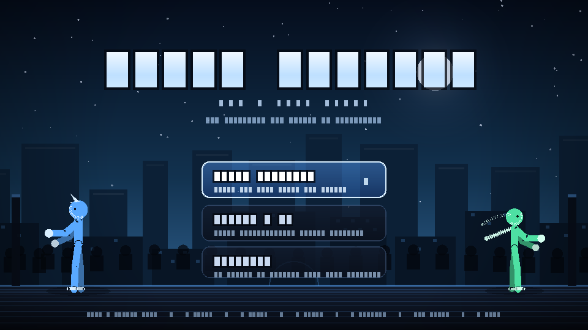
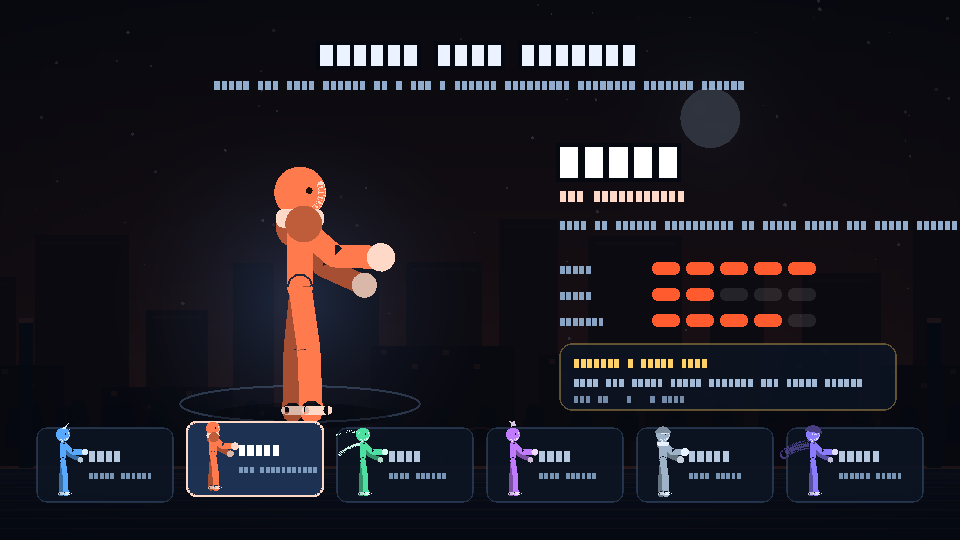
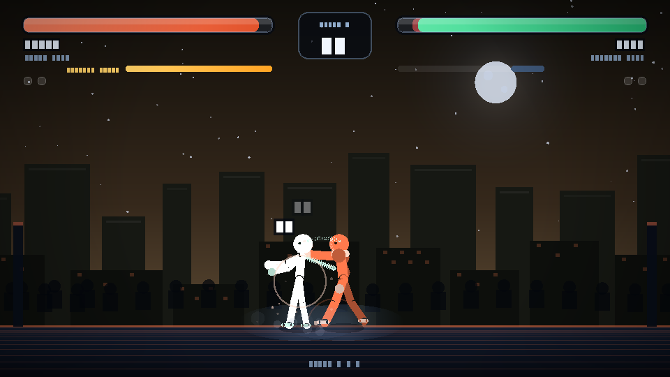

# Stick Fighter · RIP build

A self-contained, dependency-free browser fighting game — six fighters, a five-level story gauntlet, local 1v1 and a
training mode. Everything (art, animation, sound) is generated at runtime from code: no images, no audio files, no
network requests, no build step.

**Play:** https://thealphaleopard.github.io/stickfighter-rip/



> **About the name.** This repo started as an attempt to mirror the game on `stickfighter.io`. That game is a
> commercial HTML5 title by **ARF Game Studio** published through Poki, so its files are not redistributed here. What
> ships instead is an original game written for this repository. Background and the site analysis:
> [`docs/RIP-ANALYSIS.md`](docs/RIP-ANALYSIS.md). Why the Pages URL used to 404: it had no `index.html` at all — see
> [Boot status](#boot-status).

---

## Contents

| Path | What it is |
| --- | --- |
| `index.html` | Shell: canvas, splash, crash panel, touch pad, controls legend |
| `css/style.css` | Layout, chrome, responsive + touch rules |
| `js/core.js` | Constants, math helpers, canvas utilities, AI difficulty table |
| `js/roster.js` | The six fighters (stats, palettes, specials) |
| `js/audio.js` | WebAudio synth: hits, blocks, specials, menu loop |
| `js/input.js` | Keyboard / gamepad / touch → two player slots |
| `js/fx.js` | Particles, floating numbers, screen shake, parallax stage |
| `js/fighter.js` | Physics, move tables, hitboxes, specials, blocking/parry, AI |
| `js/renderer.js` | Procedural stick-figure rig, poses, floor, projectiles |
| `js/ui.js` | HUD, title, character select, pause, results |
| `js/game.js` | Match rules, screen state machine, main loop, DOM wiring |
| `tests/smoke.js` | Headless boot + gameplay test (stubbed DOM/canvas) |
| `tests/render.js` | Offline software rasteriser that writes real PNG screenshots |
| `docs/RIP-ANALYSIS.md` | What stickfighter.io serves and why it isn't mirrored |

## Play

Open `index.html`, or serve the folder:

```bash
python3 -m http.server 8080     # then visit http://localhost:8080
```

No bundler, no npm install, no transpiler. The game also runs from `file://`.

### Controls

| Action | Player 1 | Player 2 |
| --- | --- | --- |
| Move | `A` `D` / `←` `→` | `←` `→` |
| Jump (multi-jump) | `W` / `↑` | `↑` |
| Light attack | `J` | `Numpad 1` |
| Heavy attack | `K` | `Numpad 2` |
| Block (tap to parry) | `L` | `Numpad 3` |
| Special (meter ≥ 40) | `U` | `Numpad 0` |
| Pause / mute | `Esc` / `M` | — |

Gamepads map to player 1 and player 2 automatically (left stick, A/B/X/Y). Touch devices get an on-screen pad.

## Modes

- **Story gauntlet** — beat all five rivals in order; health carries over partially between levels and the AI ramps up
  (faster reactions, more blocking, higher damage).
- **Versus · 2P** — local head-to-head, best of three rounds, both players on one keyboard or two gamepads.
- **Training** — infinite health, no timer, resets instead of knockouts.

## Fighters

| Fighter | Style | Special |
| --- | --- | --- |
| Bolt | fastest hands, low power | **Volt Rush** — dash-punch across the screen |
| Brick | slow, heavy hitter | **Quake Slam** — leap and crash down, area shockwave |
| Kaze | triple jump, aerial pressure | **Cyclone Kick** — three-hit spinning kick |
| Nova | zoner | **Star Shot** — slow heavy projectile |
| Titan | armored bruiser | **Iron Rush** — armored shoulder charge |
| Shade | mobility | **Shadow Step** — blink behind the target and strike |

## How it works

- **Fixed-step simulation.** `requestAnimationFrame` calls are accumulated into a 120 Hz step so hit windows and
  movement are frame-rate independent; timers use `performance.now()` deltas clamped to 20 fps minimum.
- **Hit resolution.** Attacks queue hits during the fighter update and resolve them after *both* fighters have moved,
  so two fighters attacking on the same frame **trade** instead of the first one always winning.
- **Blocking and parry.** Holding block reduces damage to 18% and adds block-stun; pressing block *within 160 ms* of an
  incoming hit is a **parry** — the attacker is counter-stunned, you gain meter, and the hit does nothing.
- **Rendering.** Every fighter is a jointed rig (hip → neck → head, thighs/shins, upper/forearms) posed analytically per
  state, with accessories drawn per character. The stage is a generated skyline with parallax, twinkling stars, a moon
  halo and a bobbing crowd. Effects are pooled particles (sparks, dust, rings, slashes, floating damage).
- **Audio.** Short WebAudio tones and filtered noise bursts are synthesised on demand — no files, and the menu music is
  a 16-step loop built from the same synth.




## Tests

```bash
node tests/smoke.js      # 43 assertions: boot, menus, combat, specials, versus, pause, soak
node tests/render.js     # renders screenshots/*.png with an internal software canvas
```

`tests/smoke.js` stubs a minimal DOM + Canvas2D context, then drives the **real** game: it boots, walks the menus with
synthetic key events, fights scripted matches, fires all six specials, plays a versus round with both controllers,
pauses, returns to the menu and soaks idle frames. Any exception, `NaN` coordinate or degenerate draw call fails the
run.

`tests/render.js` goes further: it implements enough of Canvas2D (affine transforms, path flattening, even-odd scanline
fills, thick strokes, gradients) to rasterise the real frames to PNG, which is how the screenshots in this README were
produced without a browser.

## Boot status of the published URL

| | |
| --- | --- |
| URL | `https://thealphaleopard.github.io/stickfighter-rip/` |
| Reported state before this branch | HTTP GitHub Pages **404 “There isn't a GitHub Pages site here.”** |
| Pages configuration | enabled, `build_type: legacy`, source `main:/`, last build `built` |
| Repository contents | `README.md` only — no `index.html`, no assets |
| Cause | a Pages site with no `index.html` has nothing to boot |
| After this branch is on `main` | the game boots from `index.html` |

## Deployment

The site is plain static files, so it deploys two ways:

1. **Pages from the branch (current configuration):** Settings → Pages → *Deploy from a branch* → `main` `/ (root)`.
   Merging is all that's required; `.nojekyll` stops Jekyll from touching the folder.
2. **GitHub Actions** (`.github/workflows/pages.yml`) if you ever switch Pages to *GitHub Actions*: it runs the smoke
   test, then publishes the repo root as an artifact.

## License

Original code and art in this repository: MIT. See `LICENSE`. Third-party game builds (including the commercial
"Stick Fighter" by ARF Game Studio) are **not** included and remain the property of their authors.
